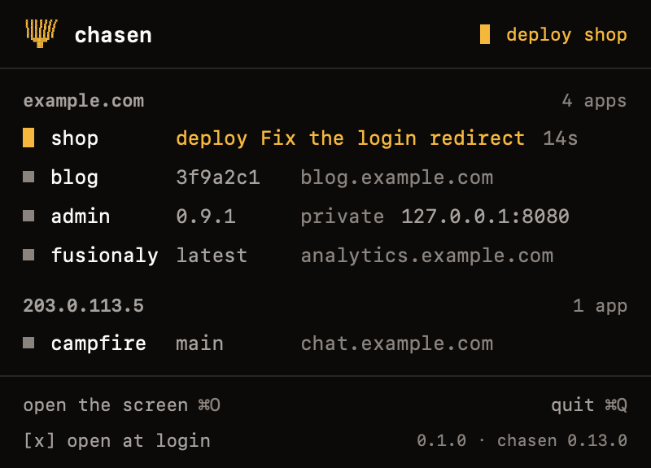

# Chasen for Mac

[](https://github.com/karloscodes/chasen-mac/actions/workflows/ci.yml) [](https://github.com/karloscodes/chasen-mac/releases) [](LICENSE)

Your Chasen servers in the menu bar of your Mac.

A whisk sits in the menu bar. It is dim while every app is up. It sways while a deploy runs on any of your servers, also a deploy that your GitHub Actions started. It turns red when an app is down. A click opens the panel: each server, its apps, and its alerts. When a deploy ends, a notification says that the app is live, with the subject of its commit.



[chasenhq.com](https://chasenhq.com) · [Docs](https://chasenhq.com/docs/)

## Install

1. Download `Chasen-<version>.dmg` from [the releases](https://github.com/karloscodes/chasen-mac/releases).
2. Open it, and drag Chasen to Applications.
3. Open Chasen. The app is signed ad hoc, not with a Developer ID, so macOS asks the first time. Open **System Settings > Privacy & Security**, and click **Open Anyway** next to Chasen.

It needs macOS 14 or newer, on Apple silicon or Intel. The `chasen` CLI is inside the app: you need no other install to see your servers.

## Use

The app shows every server that the `chasen` CLI is logged in to. With no login yet, the panel asks for your server and opens Terminal on `chasen add server <server>`.

- **Click an app** to open it in the browser. A private app has no domain: a click copies its address on the server.
- **Right-click an app** to copy its address, or to open the screen.
- **open the screen** (`⌘O`) opens `chasen` in Terminal: the logs, the history, rollback, restore. The panel shows. The screen acts.
- **open at login** starts the app with your Mac.

The app runs one `chasen overview --watch`, like [the bar of Omarchy](https://chasenhq.com/docs/omarchy/). It keeps one connection to each server, asks once a minute, and every 5 seconds while a change runs. The CLI keeps the logins: the app holds no token.

## Notifications

- **An app is live**: a deploy, a rollback, or an update ended with a new version. A click opens the app.
- **The deploy of an app ended** with the version from before. A health check that failed leaves the old version running.
- **An app is down**, or **runs again**.
- **A new error on a server**, like a full disk. A warning does not ring: it waits in the panel.

A server that does not answer rings nothing, so a Mac that wakes from sleep stays quiet.

## Development

It is a Swift package with no dependencies. On a Mac with Xcode:

```bash
swift test                  # what the app knows: the overview, the menu bar, the news
CHASEN_CLI=$(which chasen) swift run Chasen    # the app, with your chasen
bin/build 0.1.0             # build/Chasen-0.1.0.dmg, with the chasen of cli.txt inside
bin/smoke build/Chasen-0.1.0.dmg    # open the disk image and start the app from it
bin/cli 0.14.0              # put another release of chasen inside the app
```

`swift run` has no bundle, so it shows no notifications: `bin/build` makes the app that does.

CI builds the disk image on a macOS runner and keeps it with the snapshots: the panel in each state, the menu bar, and the icon (`snapshot panels <dir>`). A tag `v*` makes a release. A tag with a hyphen, like `v0.2.0-rc.1`, is a pre-release.

## License

[Apache License 2.0](LICENSE)
